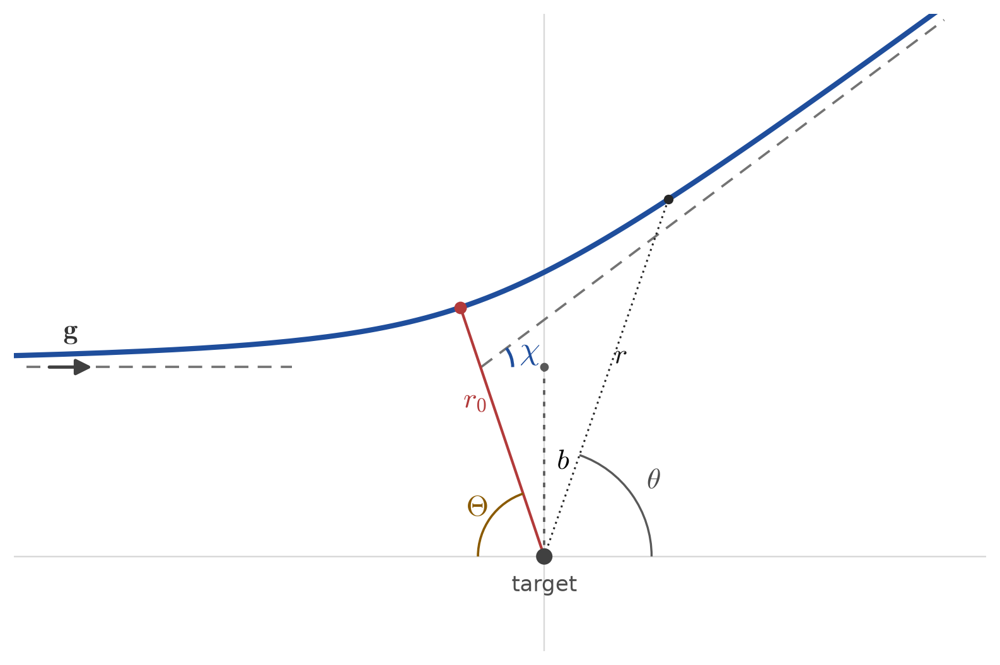

# Interactive Kinetic Theory — Course Notebooks

A collection of interactive Jupyter notebooks for a course on the **kinetic theory
of plasmas**. Each notebook takes one problem, states it, and lets you *play* with the
relevant physics: choose species, temperatures, densities, drift velocities, interaction
potentials or impact parameters and watch every curve respond. The notebooks are
self-contained; no coding is required to run the interactive figures.

## Contents

| Notebook | Problem | What you can explore |
|----------|---------|---------------------|
| [`notebooks/01_drifting_maxwellian.ipynb`](notebooks/01_drifting_maxwellian.ipynb) | The drifting Maxwellian | Two-term expansion, speed / energy / probability distributions, species and temperature dependence |
| [`notebooks/02_binet_rutherford.ipynb`](notebooks/02_binet_rutherford.ipynb) | Binet's equation and Rutherford's formula | Collision trajectories, deflection angle χ(b) with a velocity family, fixed-b speed scan χ(g), effective potential, hard sphere vs inverse power law, argon electron and ion cross sections |

More notebooks will be added following the same structure.

## Notebook guide

### 01 — The drifting Maxwellian

Start from the isotropic Maxwellian $f_0$ and its anisotropic correction
$\mathbf f_1$, then compare the two-term expansion with the exact drifting
Maxwellian. The dashboard controls the species, temperature, density and drift
velocity. The notebook explores the speed distribution $f_s(v)$, the energy
distribution $f_e(u)$ and the energy probability function $f_p(u)$, including the
log-linear behaviour of $f_p$.

### 02 — Binet's equation and Rutherford's formula

Reduce a binary collision to the relative motion in a central potential, then explore
how the trajectory and the deflection angle depend on the impact parameter, the
incoming speed and the interaction potential. The potential menu offers a hard sphere
or an inverse-power-law potential $U=k/r^n$, with $n=1$ corresponding to Coulomb. The
sign of the interaction is fixed by the pair: like charges repel, opposite charges
attract, and neutral pairs have no Coulomb force at $n=1$ (the hard-sphere and custom
power-law interactions are repulsive). The notebook also covers the effective
potential, the turning point $r_0$, and a fixed-impact-parameter scan showing why
$\chi$ changes with $g$ even when the normalized curve $\chi(b/\ell)$ does not. The
final content section loads the tabulated argon cross sections in `crossSections/` and
compares electron–argon elastic, excitation and ionization channels with ion–argon
isotropic and backscattering (charge-exchange) cross sections.

<p align="center">
  
</p>

<p align="center"><em>Collision geometry used in notebook 02: impact parameter b,
closest approach r₀, swept angle Θ and asymptotic deflection χ.</em></p>

## Repository layout

```text
.
├── environment.yml
├── README.md
├── crossSections/
│   └── Ar_*.txt
└── notebooks/
    ├── 01_drifting_maxwellian.ipynb
    ├── 02_binet_rutherford.ipynb
    └── figures/
        └── binet_geometry.png
```

---

## Requirements

* [Miniconda](https://docs.conda.io/en/latest/miniconda.html) or
  [Anaconda](https://www.anaconda.com/download) (or `mamba` / `micromamba`).
* A working internet connection for the first environment creation (packages are
  downloaded once and cached afterwards).

Everything else (Python 3.11+, JupyterLab, NumPy, SciPy, Matplotlib, ipywidgets,
ipympl, Plotly and anywidget) is installed automatically from `environment.yml`.

---

## Installation

The commands are identical on every platform; only the terminal differs.
Run them **from the repository root** (the folder that contains `environment.yml`).

### Linux / macOS

Open a terminal, then:

```bash
# 1. create the environment (only once)
conda env create -f environment.yml

# 2. activate it
conda activate ktic-interactive

# 3. launch JupyterLab
jupyter lab
```

If you use `mamba` (faster solver), simply replace `conda` with `mamba`:

```bash
mamba env create -f environment.yml
mamba activate ktic-interactive
```

### Windows

Open the **"Anaconda Prompt"** (or **"Miniconda Prompt"**) from the Start menu —
*not* the plain Command Prompt — so that `conda` is available.
`cd` into the repository folder, then run exactly the same commands:

```bat
:: 1. create the environment (only once)
conda env create -f environment.yml

:: 2. activate it
conda activate ktic-interactive

:: 3. launch JupyterLab
jupyter lab
```

Using **PowerShell** instead of the Anaconda Prompt? First enable conda for
PowerShell once:

```powershell
conda init powershell
```

Then close and reopen PowerShell and use the same commands as above.

> Tip (Windows): if you get an error that `conda` is not recognized, make sure you
> are in the Anaconda/Miniconda Prompt (or that `conda init` has been run for your shell),
> and that the Miniconda/Anaconda `Scripts` folder is on your `PATH`.

---

## Using the notebooks

1. `jupyter lab` opens a browser tab. In the file browser on the left, open the
   `notebooks/` folder and double-click a notebook.
2. Make sure the kernel (top-right of the notebook) is **ktic-interactive**.
3. Run the cells from top to bottom (`Run` ▸ `Run All Cells`).
4. Move the sliders — every figure below updates automatically.

The interactive widgets rely on `ipywidgets`. With the pinned versions from
`environment.yml` (ipywidgets ≥ 8) **no manual JupyterLab extension install is needed**.

> If a figure looks blank when you first open a notebook, run the cells. The images
> are generated by the interactive widgets and are not guaranteed to appear until the
> notebook has been executed in your kernel.

---

## Updating or removing the environment

```bash
# update to match a modified environment.yml
conda env update -f environment.yml --prune

# remove it completely
conda env remove -n ktic-interactive
```

---

## Troubleshooting

| Problem | Fix |
|---------|-----|
| Widgets don't show up, or show `HBox(...)` as text | Make sure the notebook is using the `ktic-interactive` kernel and that `ipywidgets` is installed in that environment (`conda list ipywidgets`). |
| `conda: command not found` on Windows | Use the **Anaconda Prompt**, or run `conda init powershell` and reopen the shell. |
| Plots don't appear | Run the setup cells first (they contain the imports), then re-run the plotting cell. |
| Figures are blank after opening a notebook | Run **Run All Cells**; widget-generated images may not be stored in the saved notebook. |
| Using VS Code instead of JupyterLab | Select the **ktic-interactive** environment as the notebook kernel (top-right kernel picker). |
